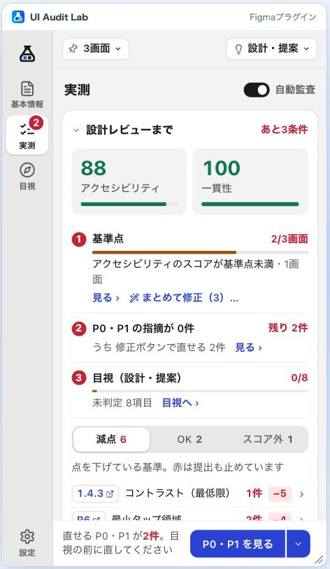
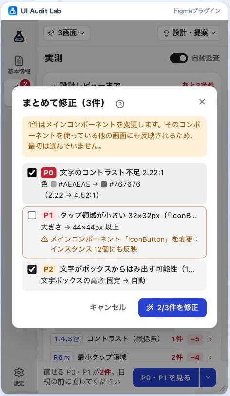
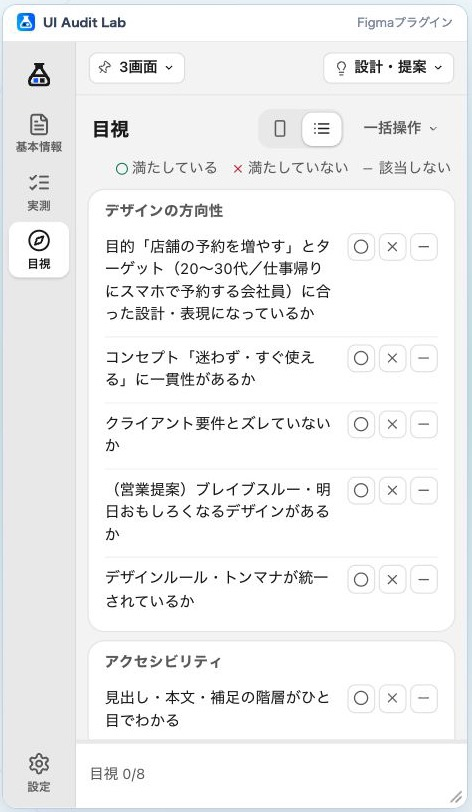

# AI Design Kit — AIで一定水準のUIを作るための軽量デザインキット

AI（Claude Code など）を使って画面を作るチームが、**大規模なデザインシステムを持たずに、UI の品質と速度を両立する**ためのキットです。
AIが読むルールと素材、AIに作らせ・レビューさせる手順（Claude Code のスキル）、効果の測り方、引き継ぎ資料を、1つのリポジトリにまとめています。

特定の顧客・サービスに依存しない汎用版です。`<…>` の欄を導入先に合わせて埋めて使います。

---

## 成果物と置き場所

| 成果物 | 中身 | 置き場所 | 状態 |
|---|---|---|---|
| **A. 方針・ロードマップ** | あるべき姿、MVP と次フェーズの切り分け、12週の工程、体制、評価指標／導入前の確認事項 | [docs/A_policy-roadmap/](docs/A_policy-roadmap/) | テンプレート |
| **B. AI参照用デザインルール** | UX/UI 基本原則（B-1）、デザインプロセス（B-2）、メンテナンス（B-3）、チェックリスト／命名・構造のルール5本 | [docs/B_design-rules/](docs/B_design-rules/)・[guidelines/rules/](guidelines/rules/) | 初版（導入先で合意して正式版に） |
| **C. デザイン素材** | トークン（json/css）、基本部品の CSS、部品の索引、レイアウトと画面テンプレート、Figma ライブラリの構成案、見本ページ | [guidelines/kit/](guidelines/kit/) | **枠組みのみ・値は仮** |
| **D. PoC 検証** | 計測方法、計測シート、レポートのひな形、記入例（過去の実測を匿名化） | [docs/D_poc-verification/](docs/D_poc-verification/) | テンプレート＋計測方法 |
| **E. 引き継ぎ資料** | 準備、運用ガイド、更新の手順、次フェーズの候補 | [docs/E_handover/](docs/E_handover/) | 完成 |
| AIの作業手順 | Claude Code のルール（CLAUDE.md・PROTOTYPE.md）とスキル18個 | [.claude/](.claude/) | 完成 |

---

## 考え方

1. **ルールと素材が、AIの唯一の基準**。どのAIツールも同じファイルを読む。
2. **推測で埋めない**。素材にない部品は作り込まず、「素材に不足」として報告する。
3. **判断は人、作業はAI**。何を足すか、出してよいかは人が決め、反映と再チェックはAIが行う。
4. **増やすのは、使われたものだけ**。網羅を目指さない。

```
ルール・素材 ──AIが読む──▶ AI（スキル）──生成──▶ 画面 ──▶ 自己レビュー → 画面レビュー（ツール＋人）
      ▲                                                                      │
      └──────────────── 見つかった不足は、人が判断して戻す ◀──────────────────┘
```

---

## フォルダ構成

```
.claude/
  CLAUDE.md          生成物の置き場、用語、命名など AI への共通ルール
  PROTOTYPE.md       プロトタイプを作るときの手順とルール
  skills/            Claude Code のスキル（一覧は skills/README.md）
.mcp.json            Figma MCP の接続先
docs/
  A_policy-roadmap/  A. 方針・ロードマップ
  B_design-rules/    B. 原則・プロセス・メンテナンス・チェックリスト
  D_poc-verification/ D. 計測方法・レポートのひな形
  E_handover/        E. 準備・運用・更新・次フェーズ
  assets/            画面レビューツール（Figma プラグイン）の画面例
guidelines/
  rules/             B. 命名・構造のルール5本（AIが○×で判定できる形式）
  kit/               C. デザイン素材（共通）
  design-system-map.md  Figma の所在
generated/           AIが作った成果物の置き場（プロトタイプ・レポート）
tools/serve.js       確認用の簡易サーバー
```

---

## 始め方

1. [docs/E_handover/setup.md](docs/E_handover/setup.md) で Claude Code と Figma MCP を準備する。
2. [docs/A_policy-roadmap/mvp-scope-checklist.md](docs/A_policy-roadmap/mvp-scope-checklist.md) で導入先に確認し、MVP の範囲を決める。
3. [docs/A_policy-roadmap/policy-roadmap-template.md](docs/A_policy-roadmap/policy-roadmap-template.md) を埋めて合意する。
4. Figma ライブラリを作り、同期スキルで `guidelines/kit/` の仮の値を置き換える。
5. PoC の画面を作る前に Before を測り（[D](docs/D_poc-verification/measurement-method.md)）、キットを使って After を測る。

素材の見本は `node tools/serve.js` を起動して `http://localhost:8765/guidelines/kit/components-showcase.html` で確認できます。

---

## 画面レビューツールの画面例

`docs/assets/` に、画面レビューに使う Figma プラグイン（UI Audit Lab）の画面例（デモデータ）を置いています。

| 実測 | まとめて修正 | 目視チェック |
|---|---|---|
|  |  |  |
